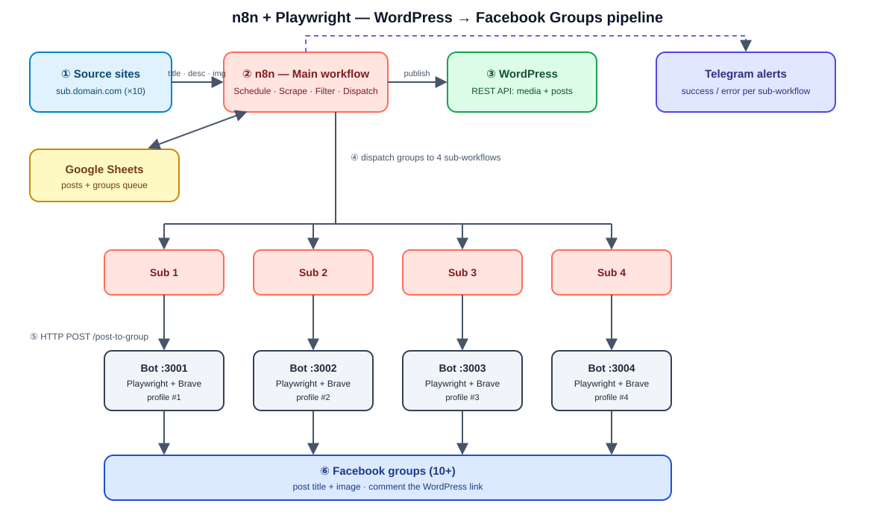

**English** | [العربية](README.ar.md)

# n8n + Playwright: WordPress → Facebook Groups Automation

A portfolio project that shows how to chain **n8n**, **REST APIs**, **Google Sheets** and
**Node.js / Playwright bots running on separate ports** into a single automated pipeline.



## What it does

1. **Collect** – n8n pulls articles (title, description, image) from a list of source sites.
2. **Publish** – each article is created on **WordPress** through its REST API (image uploaded as media, then the post).
3. **Store** – everything is tracked in **Google Sheets** (queue, status, WordPress URL).
4. **Distribute** – n8n splits the Facebook groups across **4 sub-workflows**. Each one calls its own
   **Playwright bot** (own port, own Brave profile) that posts the title + image in a group
   and drops the WordPress link in the first comment.
5. **Monitor** – success and errors are sent to **Telegram**.

Running 4 bots in parallel is the point of the project: it demonstrates multi-process
orchestration, API design, queues, and error handling — not volume.

## Tech stack

| Layer | Tool |
|-------|------|
| Orchestration | n8n (self-hosted, Docker) |
| Browser automation | Node.js 18+, Playwright, Brave (persistent profiles) |
| Bot API | Express (`/post-to-group`, `/health`) |
| CMS | WordPress REST API (Application Passwords) |
| Data store | Google Sheets |
| Alerts | Telegram Bot API |

## Repository structure

```
.
├── docs/architecture.svg      # diagram above
├── playwright-bot/
│   ├── server.js              # one bot = one port = one Brave profile
│   ├── start-all.js           # launches BOT_COUNT bots (3001..3004)
│   └── package.json
├── scripts/first-login.js     # one-time manual Facebook login per profile
├── workflows/                 # exported n8n workflows (main + sub-1..4)
├── docker-compose.yml         # n8n
├── .env.example
└── README.md
```

## Prerequisites

- Node.js **18+**
- Docker + Docker Compose
- Brave browser installed
- A WordPress site (5.6+) with an **Application Password**
- A Google account (Sheets API credentials in n8n)
- A Telegram bot token (optional, for alerts)

## Installation

### 1. Clone and configure

```bash
git clone https://github.com/<your-username>/n8n-wp-facebook-automation.git
cd n8n-wp-facebook-automation
cp .env.example .env        # then edit BRAVE_PATH and API_KEY
```

### 2. Start n8n

```bash
docker compose up -d
```

Open <http://localhost:5678> and create your owner account.

### 3. Install and start the bots

```bash
cd playwright-bot
npm install
npx playwright install        # not required for Brave, but harmless
npm run start:all             # starts :3001 :3002 :3003 :3004
```

Check them:

```bash
curl -H "x-api-key: $API_KEY" http://localhost:3001/health
```

### 4. Log in to Facebook once per bot

Each bot has its own Brave profile, so each one needs a one-time manual login:

```bash
node scripts/first-login.js bot-1   # log in, close the window
node scripts/first-login.js bot-2
node scripts/first-login.js bot-3
node scripts/first-login.js bot-4
```

Sessions are stored in `playwright-bot/profiles/` (git-ignored).
Stop the bots before running this script — a Brave profile can only be open once.

### 5. Prepare WordPress

1. *Users → Profile → Application Passwords* → create one.
2. Test it:

```bash
curl -u "user:APP_PASSWORD" https://your-site.com/wp-json/wp/v2/users/me
```

### 6. Prepare Google Sheets

Create one spreadsheet with two tabs:

**`posts`**

| title | description | image_url | wp_post_id | wp_url | status |
|-------|-------------|-----------|------------|--------|--------|

**`groups`**

| group_url | bot (1-4) | last_posted_at |
|-----------|-----------|----------------|

### 7. Import the workflows into n8n

1. In n8n: **Workflows → Import from file** → import `workflows/sub-1.json` … `sub-4.json` first, then `workflows/main.json`.
2. Create credentials: **Google Sheets**, **WordPress** (HTTP Basic Auth), **Telegram**, and an **HTTP Header Auth** with `x-api-key = <API_KEY>`.
3. In `main`, point each *Execute Workflow* node to the matching sub-workflow.
4. In each sub-workflow, the HTTP Request node must target:

   | Sub-workflow | URL |
   |--------------|-----|
   | Sub 1 | `http://host.docker.internal:3001/post-to-group` |
   | Sub 2 | `http://host.docker.internal:3002/post-to-group` |
   | Sub 3 | `http://host.docker.internal:3003/post-to-group` |
   | Sub 4 | `http://host.docker.internal:3004/post-to-group` |

5. Activate the workflows.

## Bot API

`POST /post-to-group` (header `x-api-key`)

```json
{
  "groupUrl": "https://www.facebook.com/groups/123456789",
  "title": "Article title",
  "description": "optional text added under the title",
  "imageUrl": "https://your-site.com/wp-content/uploads/2026/10/cover.jpg",
  "wpUrl": "https://your-site.com/my-article/"
}
```

Response: `{ "ok": true, "bot": "bot-1", "groupUrl": "..." }`
On failure: HTTP 500 with `error` and a `screenshot` path for debugging.

Jobs sent to the same bot are queued and executed **one at a time**.

## Configuration

| Variable | Default | Description |
|----------|---------|-------------|
| `BRAVE_PATH` | – | Path to the Brave executable |
| `API_KEY` | – | Shared secret between n8n and bots |
| `BOT_COUNT` | 4 | Number of bots |
| `BASE_PORT` | 3001 | First port |
| `MIN_DELAY_MS` / `MAX_DELAY_MS` | 4000 / 12000 | Random human-like pause between actions |
| `HEADLESS` | false | Run Brave without a window |

## Troubleshooting

- **n8n can't reach the bot** – use `host.docker.internal` (already mapped in `docker-compose.yml`) and make sure the bot listens on `0.0.0.0`.
- **`Target page, context or browser has been closed`** – the profile is already open in another Brave window. Close it.
- **Selector timeouts** – Facebook changes its UI often. Adjust the role/text patterns in `playwright-bot/server.js` (EN/FR patterns are included).
- **Checkpoint / login screen** – re-run `scripts/first-login.js <bot>`.

## Responsible use

This project is a technical demonstration of automation, API integration and multi-process orchestration.

- Automating Facebook can violate its Terms of Service and may get accounts restricted. Use test accounts and groups you own or manage, or where you have the admins' permission.
- Only republish content you own or have a licence to use.
- Keep the delay settings and respect each group's rules and posting limits.

The author is not responsible for misuse.

## Roadmap

- [ ] Per-group daily caps and cool-down stored in Google Sheets
- [ ] Docker image for the bots
- [ ] Dashboard (run history, success rate)
- [ ] Retry with exponential back-off

## License

MIT
